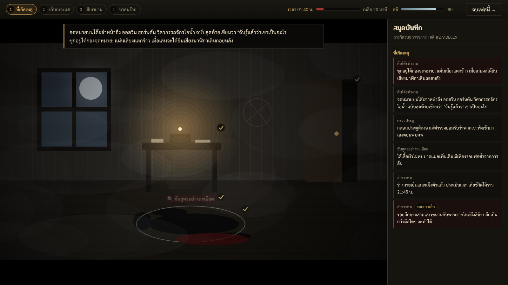

# เงาในหมอกควัน (likeDetective) — demo

Roguelike สืบสวนในเมืองเครื่องจักรไอน้ำที่ปกคลุมด้วยหมอกควัน คดีสุ่มใหม่ทุกรอบ ไม่มีการต่อสู้ มีแค่เบาะแส เวลา และสติ



สรุปการออกแบบและสิ่งที่ demo ตัดสินใจไปก่อนอยู่ที่ [docs/design.md](docs/design.md)

## รัน

```bash
npm install
npm run dev-nolog     # http://localhost:8080
npm test              # เทสต์ตัวสุ่มคดี (2,000 seed ต่อชุด) และ flow ของรัน
npm run typecheck
npm run build-nolog   # build ลง dist/
```

## โครงสร้าง

| Path                       | หน้าที่                                                                                                                                                   |
| -------------------------- | --------------------------------------------------------------------------------------------------------------------------------------------------------- |
| `src/game/core/`           | logic ล้วน ไม่พึ่ง Phaser/React: ข้อมูล (`data.ts`, `perks.ts`), สุ่มคดี (`caseGen.ts`), กฎของรัน (`run.ts`), Codex (`codex.ts`), store กลาง (`store.ts`) |
| `src/game/scenes/Stage.ts` | ฉาก Phaser ฉากเดียว วาดห้องที่เกิดเหตุ แผนที่ และฉากหลัง พร้อม hotspot                                                                                    |
| `src/ui/`                  | UI React: HUD, สมุดบันทึก, สืบพยาน, กระดานชี้ตัว, draft, เฉลย, Codex                                                                                      |
| `tests/`                   | Vitest                                                                                                                                                    |

Phaser กับ React ใช้ `store` ตัวเดียวกันใน `src/game/core/store.ts` ทุก action เป็นฟังก์ชัน pure ใน `run.ts` จึงเทสต์ได้โดยไม่ต้องเปิด browser

ใส่ seed (hex) ในหน้าแรกเพื่อเล่นคดีเดิมซ้ำได้

Template เดิมคือ Phaser 4 + React + TypeScript + Vite (`log.js` และสคริปต์ `dev`/`build` ยังเป็นของ template)
